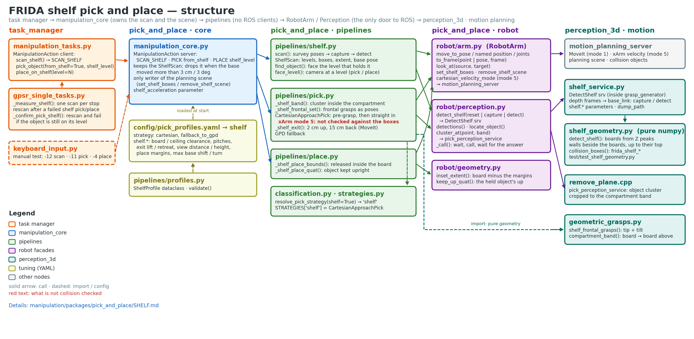

# Shelf pick and place

The robot measures the shelf in front of it with the eye-in-hand ZED2 (no per-arena
heights), then picks from and places on its levels. A shelf pick or place without a
scan from where the robot stands fails.

## The flow and its files



| Goal | What `manipulation_core` does | Result |
| --- | --- | --- |
| `SCAN_SHELF` | Visits the two survey poses, captures each view, detects the shelf, files what the camera sees under its level, adds the boxes to the scene and keeps the scan while the base stays put | `shelf_levels`, each with `objects` |
| `PICK`, `pick_params.from_shelf` (optional `shelf_level` hint) | Finds the object's level (the hint, then where the scan saw it, then every level), faces it, grasps, backs out | `shelf_level` it picked from |
| `PLACE`, `place_params.shelf_level = N` | Faces level N and places inside the scanned board | |

Manual test: `keyboard_input.py` -12 (scan), -11 (pick), -4 (place on a level).

## Detection (`perception_3d`)

`DetectShelf` is hosted by `grasp_generator`, which owns the depth image, intrinsics
and TF. It only detects: the boxes come back in the answer and only the core writes
them to the scene.

1. Frames captured at each survey pose accumulate in `base_link`.
2. Crop, 1 cm voxels, normals. Up-facing horizontal points give one Z peak per board;
   peaks narrower than 60 % of the shelf or with gaps are objects. Down-facing peaks
   give the thickness and a board above the camera; vertical planes at the extremes
   are the walls. Only vertical points inside the shelf's volume count (not below the
   lowest board, not in front of the boards), and a side wall seen in a single
   compartment (15 cm) is enough.
3. Boards and walls become boxes (`frida_shelf_*`), grown 2 cm into the free space
   except the board tops. Walls run from the floor up to the highest wall point seen
   (an open-top shelf's walls rise past its top board). A wall that was not seen is
   still boxed at the boards' edge (`assume_walls`): a missing box let MoveIt plan
   through a real wall.

On-site tunables are `grasp_generator` parameters under `shelf.`: the search box
(`x_min`, `x_max`, `y_half`, `z_min`, `z_max`), `min_width_fraction`,
`min_level_spacing`, `min_level_points`, `side_wall_min_height`, `assume_walls`,
`walls_to_floor`.

| Survey pose | Joints (deg) | Camera in base_link | Sees |
| --- | --- | --- | --- |
| `shelf_survey_high` | -90, -45, -90, 0, 20, 45 | (0.19, 0.06, 1.40), 23 deg down | upper boards, a board above the camera |
| `shelf_survey_low` | -90, -105, 0, 0, 15, 45 | (0.21, 0.06, 0.95), 48 deg down | the low compartments |

## Pick: the `shelf` strategy

`classification.py` sends every shelf pick to the `shelf` profile:

- **Cluster.** The object is segmented inside its compartment (`compartment_band`):
  the default band merged it with the boards of a closed cabinet.
- **Frontal grasp** (`shelf_frontal_grasps`). Fingertips just past the object's middle,
  at mid height, clear of the board and the ceiling; fingers close sideways, the ZED
  points up. Tilted 10, 0, 20 deg down, and 30, 45 deg with nothing above.
- **Approach.** Pre-grasp, then straight in by xArm cartesian velocity (mode 5):
  **no collision check against the shelf boxes**. Then GPD if no frontal grasp works.
- **Exit.** Straight MoveIt paths, collision checked: 2 cm up, then back until the
  fingertips are `exit_clearance` (5 cm) out of the scanned board front, at least
  `exit_retreat` (15 cm), at most `exit_max_retreat` (45 cm). `link_eef` is the flange,
  17 cm behind the fingertips. A blocked retreat is retried in `exit_step` (5 cm) pieces. If the
  hand cannot get out, the pick fails holding the object and **no return is planned
  from inside the shelf**.

## Place

- The held object's centre stays inside the scanned board (8 cm from the front, away
  from the back and sides), and keeps the "up" it had when picked.
- When a rung fails, the next is 2 cm higher; nothing is released short of it.

## Tuning

Every shelf number is in `config/pick_profiles.yaml` → `shelf.shelf`: the frontal
grasp, the exit, facing a level, the place margins and how far the base may move
(3 cm / 3 deg) before the scan is dropped. `manipulation_core` parameters:

```bash
ros2 param set /manipulation_core shelf_acceleration 0.3    # default 0.5
ros2 param set /manipulation_core shelf_place_straight true # default false
```

## Known limits

- An object under ~12 cm (an apple) gets no frontal grasp and GPD rarely reaches it.
- The place puts `link_eef` 10 cm above the board whatever the grasp height.
- The top shelf (~1.30 m) is at the edge of the arm's reach for a place.
- A level's objects are what the survey poses see; a pick then searches the others.
